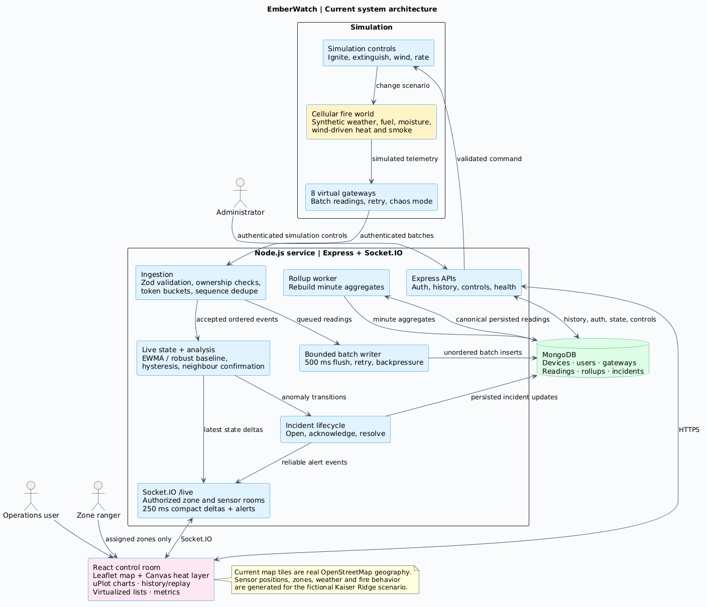

<div align="center">

# 🔥 EmberWatch

### Real-time wildfire telemetry and early-warning simulation

Monitor a virtual forest sensor network, investigate developing incidents, and watch authorized dashboards update live.


[Overview](#-overview) • [Features](#-key-features) • [Architecture](#-architecture-diagrams) • [Tech stack](#-tech-stack) • [Getting started](#-getting-started) • [FAQs](#-faqs)


</div>

---

##  Overview

EmberWatch is a MERN-stack telemetry platform built around a simulated forest fire scenario. Virtual sensors and weather stations continuously report conditions to a Node.js and Express backend. The system analyzes readings, records incidents in MongoDB, and broadcasts relevant updates through Socket.IO to users authorized for each zone.

The map uses real OpenStreetMap basemap tiles, but the **Kaiser Ridge Forest Block, sensor locations, zone boundaries, weather, and fire behavior are fictional or simulated**. EmberWatch is a demonstration—not a live wildfire detection, prediction, or public-safety system. It does not currently ingest external wildfire or weather feeds.

---

##  Key Features

<table>
  <tr>
    <td width="50%">
      <h3>📡 Live sensor telemetry</h3>
      420 virtual forest sensors, 8 weather stations, 8 gateways, and four independently subscribed zones.
    </td>
    <td width="50%">
      <h3>🗺️ Interactive monitoring map</h3>
      Leaflet map with sensor states, temperature/smoke heat layer, zone boundaries, wind, and one simulated fire-front arrow per zone (direction, apparent speed, and sensor count).
    </td>
  </tr>
  <tr>
    <td>
      <h3>🚨 Explainable incident handling</h3>
      Statistical baselines, thresholds, dwell and recovery hysteresis, nearby-sensor confirmation, offline detection, and acknowledge/resolve lifecycle.
    </td>
    <td>
      <h3>🔌 Selective real-time updates</h3>
      Authenticated Socket.IO zone and sensor rooms, compact changed-source frames, reliable alerts, reconnect snapshots, and bounded delivery queues.
    </td>
  </tr>
  <tr>
    <td>
      <h3>📈 History and replay</h3>
      MongoDB raw readings and minute rollups, sequence-based history/live merge, chart pause, time ranges, and peak-preserving downsampling.
    </td>
    <td>
      <h3>🧪 Scenario and resilience controls</h3>
      Admin ignition, extinguishing, wind, rate, and chaos controls; validation, token buckets, backpressure, retries, and pipeline metrics.
    </td>
  </tr>
</table>

---

##  Architecture Diagrams

These diagrams describe the **implemented simulated system**. The map and fire behavior are synthetic; the basemap is OpenStreetMap.

### System architecture



### Telemetry ingestion, alerting, and history/live flow


### Persisted data model


---

##  Tech Stack

| Area | Technologies |
|---|---|
| Frontend | React, Vite, Leaflet, uPlot, react-window, Lucide |
| Backend | Node.js, Express, Socket.IO |
| Database | MongoDB, Mongoose |
| Validation and security | Zod, JWT, bcrypt, Helmet, CORS, token-bucket rate limits |
| Testing and performance | Vitest, Supertest, MongoDB Memory Server, built-in load benchmark |

---

##  Telemetry and Real-Time Flow

Each event carries a source ID, monotonic sequence number, event timestamp, and sensor metrics. Gateways authenticate and submit batches through Socket.IO or the HTTP ingestion endpoint. The server validates ownership and values, applies rate limits and deduplication, updates current state, evaluates incident rules, and queues persistence.

Raw events are written to MongoDB in batches; minute rollups are rebuilt from persisted readings. Socket.IO sends compact, room-scoped changes at a UI-friendly cadence. The client subscribes before loading history, buffers overlapping live data, and merges by sequence number to avoid duplicate chart points.

**Delivery boundary:** an ingestion acknowledgement confirms bounded in-memory queue acceptance, not a durable database commit. Telemetry frames may be coalesced under transport pressure; Socket.IO is not a durable event log.

---

##  Getting Started

### Prerequisites

- Node.js 22.12 or newer and npm
- MongoDB 7 or newer, or a MongoDB Atlas database

### Install and configure

From the repository root:

```powershell
npm ci
Copy-Item .env.example .env
```

Edit `.env`. Use separate random values of at least 32 characters for `JWT_SECRET` and `FLEET_SECRET`; the standalone simulator and server must share `FLEET_SECRET`. Keep `.env` private and never commit it. The example defaults are for local development only.

Start a local development database in one terminal:

```powershell
npm run db
```

In another terminal, seed the demo accounts and start the API, simulator, and frontend:

```powershell
npm run seed
npm run dev
```

Open [http://127.0.0.1:5173](http://127.0.0.1:5173). The development setup runs Express on port 4000, the simulator separately, and Vite on port 5173. For an existing MongoDB/Atlas database, set `MONGO_URI` in `.env` instead of starting the local database helper.

<details>
  <summary><b>Local demo accounts</b></summary>
  <p>Seeding creates <code>admin@emberwatch.dev</code>, <code>ops@emberwatch.dev</code>, <code>north@emberwatch.dev</code>, <code>east@emberwatch.dev</code>, and <code>south@emberwatch.dev</code> for Administrator, Operations, North ranger, East ranger, and South/West ranger access. The default local-only demo password is <code>ember-demo</code>; change <code>DEMO_PASSWORD</code> before seeding a publicly accessible deployment. Rangers are restricted to their assigned zones.</p>
</details>

### Build and run one server

```powershell
npm run build
npm start
```

Set `SIM_EMBEDDED=1` in `.env` for this mode, then open [http://127.0.0.1:4000](http://127.0.0.1:4000). Do not run a separate simulator at the same time.

### Deploy to Render

[](https://render.com/deploy?repo=https://github.com/SantoshReddy0603/emberwatch)

`render.yaml` runs the API, the built client, and the embedded simulator as one free web service.

1. Create a free MongoDB Atlas cluster in the AWS region closest to your Render service region, without the sample dataset. Add a database user, allow network access from `0.0.0.0/0`, and copy the `mongodb+srv://` connection string with `/emberwatch` before the query string.
2. In Render choose **New → Blueprint**, select this repository, and paste the connection string into `MONGO_URI`.
3. Apply. Render generates `JWT_SECRET` and `FLEET_SECRET`, the server provisions the fleet and demo accounts on boot (`SEED_ON_START=1`), and CORS defaults to the assigned `onrender.com` URL.

The hosted simulator runs at 1 Hz with 60 minutes of raw retention so storage stays within the 512 MB free tier. Free services sleep after about 15 minutes idle and take up to a minute to wake.

---

##  Testing and Performance

Run the test suites and frontend production build:

```sh
npm test
npm run build
```

The repository includes a real ingestion/storage/Socket.IO benchmark with synthetic clients:

```sh
npm run bench -- --clients 50 --hz 10 --seconds 30 --warmup 5 --output docs/perf/local-run.json
```

One recorded local run accepted about **1,886 readings/second** with **50 synthetic Socket.IO clients** connected. This is a result from one shared Windows development machine—not a hosted capacity guarantee or a test of 50 fully rendered browsers. The benchmark report documents client-latency measurement, CPU, storage reconciliation, and other limitations: [performance methodology and results](docs/perf/README.md).

---

##  FAQs

<details>
  <summary><b>Are these real sensors or an active California fire?</b></summary>
  <p>No. Sensor locations, readings, zones, weather, and fire behavior are generated for a fictional scenario. The basemap geography and map tiles are from OpenStreetMap. No external fire or weather feed is currently connected.</p>
</details>

<details>
  <summary><b>Does the fire danger index predict a real wildfire?</b></summary>
  <p>No. It is a simulation-oriented composite based on temperature, humidity, and a wind adjustment. It is not the official Canadian Fire Weather Index, a calibrated forecast, or evacuation guidance.</p>
</details>

<details>
  <summary><b>Does every incoming reading reach every browser?</b></summary>
  <p>No. Clients subscribe to authorized zones and selected sources. Frequent telemetry is compacted or coalesced to protect responsiveness; persisted history and sequence-based merging provide the historical record.</p>
</details>

<details>
  <summary><b>Where does the map data come from?</b></summary>
  <p>The map uses standard OpenStreetMap tiles, which require an internet connection and must retain visible attribution. See the <a href="https://operations.osmfoundation.org/policies/tiles/">OpenStreetMap tile usage policy</a>.</p>
</details>

---

##  Attribution

- **OpenStreetMap contributors** provide the basemap data; attribution is shown on the map. Standard tiles follow the [OSMF tile usage policy](https://operations.osmfoundation.org/policies/tiles/).
- **Chandler Burning Index** is the basis for the temperature/humidity component of the app-specific danger score: Chandler et al., *Fire in Forestry* (1983). EmberWatch's wind adjustment and 0–100 display are application-specific.
- Animated section icons use [Google Noto Emoji](https://github.com/googlefonts/noto-emoji), licensed under Apache 2.0.
- EmberWatch uses the open-source libraries listed in the [tech stack](#-tech-stack); their licenses and notices are provided by their respective projects and package metadata.

---

<div align="center">
  <p>Built with  for the MERNIFY real-time telemetry challenge</p>
  <b>See the signal. Understand the incident.</b>
</div>
