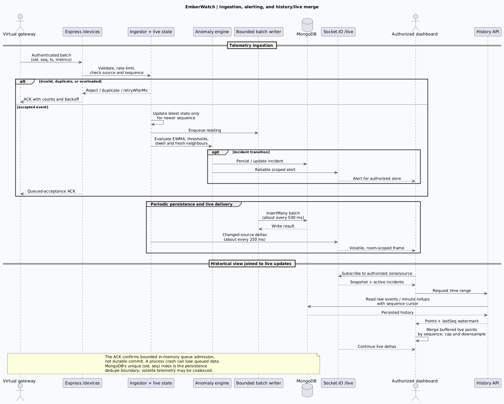
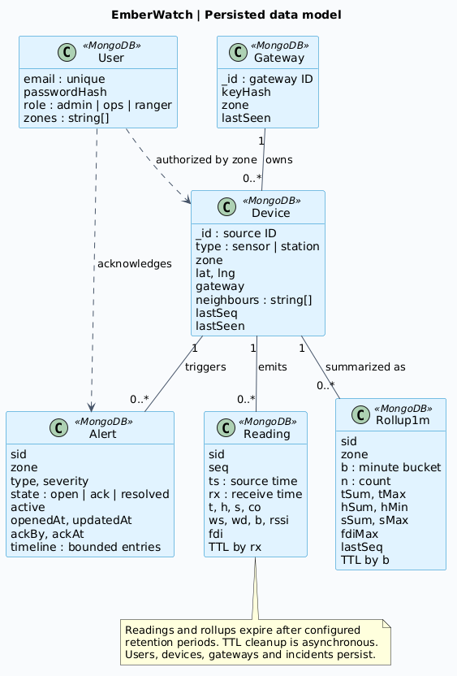

<div align="center">

# 🔥 EmberWatch

### Real-time wildfire telemetry and early-warning simulation

Monitor a virtual forest sensor network, investigate developing incidents, and watch authorized dashboards update live.


[Overview](#-overview) • [Demo accounts](#demo-accounts) • [Features](#-key-features) • [Requirements](#requirement-coverage) • [Architecture](#-architecture-diagrams) • [Data generation](#data-generation-and-ingestion) • [Real-time](#-real-time-communication) • [Getting started](#-getting-started) • [Testing](#-testing-and-performance) • [FAQs](#-faqs)


</div>

---

##  Overview

**The problem.** Large IoT deployments such as forest sensor meshes produce a continuous, high-frequency stream of readings. Many people need to watch that stream at the same time, each with a different scope: a ranger cares about one zone, a dispatcher about the whole forest. They need to see unusual behaviour within seconds, look back at what led up to it, and do all of this without the dashboard freezing or the server collapsing when readings spike, links drop, or devices resend duplicates.

**The solution.** EmberWatch is a MERN-stack telemetry platform built around a simulated forest fire scenario. Virtual sensors and weather stations continuously report conditions to a Node.js and Express backend. The system analyzes readings, records incidents in MongoDB, and broadcasts relevant updates through Socket.IO to users authorized for each zone.

The map uses real OpenStreetMap basemap tiles, but the **Kaiser Ridge Forest Block, sensor locations, zone boundaries, weather, and fire behavior are fictional or simulated**. EmberWatch is a demonstration—not a live wildfire detection, prediction, or public-safety system. It does not currently ingest external wildfire or weather feeds.

---

## Demo Accounts

The sign-in page has one-click buttons for every account under **Explore the simulation**, or sign in manually:

| Role | Email | Password | What this account can do |
|---|---|---|---|
| Administrator | `admin@emberwatch.dev` | `ember-demo` | All four zones, pipeline metrics, simulator controls (ignite, extinguish, wind, sampling rate, chaos mode), acknowledge incidents |
| Operations | `ops@emberwatch.dev` | `ember-demo` | All four zones, pipeline metrics, acknowledge incidents |
| North ranger | `north@emberwatch.dev` | `ember-demo` | Zone North only: live map, charts, history, acknowledge its incidents |
| East ranger | `east@emberwatch.dev` | `ember-demo` | Zone East only: live map, charts, history, acknowledge its incidents |
| South / West ranger | `south@emberwatch.dev` | `ember-demo` | Zones South and West only: live map, charts, history, acknowledge their incidents |

- All telemetry is simulated. Accounts are created by `npm run seed`, or on every boot when `SEED_ON_START=1`.
- Open the Administrator and a ranger account in two different browsers (or one normal and one private window) to see independent, zone-filtered live updates side by side.

---

##  Key Features

<table>
  <tr>
    <td width="50%">
      <h3>📡 Live sensor telemetry</h3>
      420 virtual forest sensors, 8 weather stations, 8 gateways, and four independently subscribed zones.
    </td>
    <td width="50%">
      <h3>🗺️ Interactive monitoring map</h3>
      Leaflet map with sensor states, temperature/smoke heat layer, zone boundaries, wind, and one simulated fire-front arrow per zone (direction, apparent speed, and sensor count).
    </td>
  </tr>
  <tr>
    <td>
      <h3>🚨 Explainable incident handling</h3>
      Statistical baselines, thresholds, dwell and recovery hysteresis, nearby-sensor confirmation, offline detection, and acknowledge/resolve lifecycle.
    </td>
    <td>
      <h3>🔌 Selective real-time updates</h3>
      Authenticated Socket.IO zone and sensor rooms, compact changed-source frames, reliable alerts, reconnect snapshots, and bounded delivery queues.
    </td>
  </tr>
  <tr>
    <td>
      <h3>📈 History and replay</h3>
      MongoDB raw readings and minute rollups, sequence-based history/live merge, chart pause, time ranges, and peak-preserving downsampling.
    </td>
    <td>
      <h3>🧪 Scenario and resilience controls</h3>
      Admin ignition, extinguishing, wind, rate, and chaos controls; validation, token buckets, backpressure, retries, and pipeline metrics.
    </td>
  </tr>
</table>

---

## Requirement Coverage

How each MERNIFY core requirement and technical guideline is met, and where to find it in the code.

| Requirement | How EmberWatch meets it | Where |
|---|---|---|
| Ingest continuous streams from multiple sources | 428 simulated sources (420 sensors, 8 weather stations) report through 8 authenticated gateways over Socket.IO, with an HTTP endpoint as an alternative | [`simulator/`](simulator), [`server/src/ingest/deviceNs.js`](server/src/ingest/deviceNs.js), [`server/src/api/ingest.js`](server/src/api/ingest.js) |
| Process events and maintain updated state | In-memory latest state per source; out-of-order events are stored but never roll the live cursor back | [`server/src/ingest/ingestor.js`](server/src/ingest/ingestor.js), [`server/src/pipeline/stateStore.js`](server/src/pipeline/stateStore.js) |
| Store telemetry for historical retrieval | Raw readings in batched unordered inserts, rebuilt minute rollups, TTL retention | [`server/src/pipeline/writer.js`](server/src/pipeline/writer.js), [`server/src/pipeline/rollup.js`](server/src/pipeline/rollup.js), [`server/src/models/`](server/src/models) |
| Broadcast relevant updates in real time | `/live` namespace with zone and sensor rooms; 250 ms delta frames carry only changed sources | [`server/src/realtime.js`](server/src/realtime.js), [`server/src/telemetryDelivery.js`](server/src/telemetryDelivery.js) |
| Interactive visualizations | Leaflet map with canvas markers and heat layer, fire-front arrows, uPlot charts, KPI sparklines, metrics panel | [`client/src/SensorMap.jsx`](client/src/SensorMap.jsx), [`client/src/Chart.jsx`](client/src/Chart.jsx), [`client/src/App.jsx`](client/src/App.jsx) |
| History alongside live without duplicates | Subscribe first, buffer live data, fetch history with a sequence cursor, merge and deduplicate by `(source, seq)` | [`client/src/history.js`](client/src/history.js), [`server/src/api/read.js`](server/src/api/read.js) |
| Stay responsive under frequent updates | Store publishes at most 4 times per second via `requestAnimationFrame`, 10,000-point cap, peak-preserving downsampling, virtualized lists | [`client/src/store.js`](client/src/store.js), [`client/src/AlertList.jsx`](client/src/AlertList.jsx) |
| Node.js + Express, MongoDB, React, Socket.IO | Express 5 API and static client, Mongoose models, React 19 + Vite, Socket.IO for both ingestion and dashboards | [`server/`](server), [`client/`](client) |
| Batching, throttling, aggregation | Gateway batches, 500 ms writer batches, 250 ms broadcast tick, latest-packet coalescing, minute rollups | see above |
| Socket.IO rooms / namespaces | `/devices` for gateways, `/live` for dashboards; per-zone, per-sensor, alert and metrics rooms | [`server/src/realtime.js`](server/src/realtime.js) |
| Event identity, timestamps, duplicates, out-of-order | Every reading has source ID, monotonic `seq` and source timestamp `ts`; dedup ring plus unique `(sid, seq)` index; clock-skew bounds | [`shared/schemas.js`](shared/schemas.js), [`server/src/models/Reading.js`](server/src/models/Reading.js) |
| Input validation and rate limiting | Zod schemas for every batch, command and query; per-source and per-gateway token buckets with `retryAfterMs`; login and control rate limits; 256 KB body limit | [`shared/schemas.js`](shared/schemas.js), [`server/src/ingest/tokenBucket.js`](server/src/ingest/tokenBucket.js), [`server/src/auth.js`](server/src/auth.js) |
| Authentication and access control | JWT sign-in with bcrypt hashes; roles (admin, operator, ranger) and zone scopes checked on every HTTP request and socket subscription; gateway keys stored only as hashes | [`server/src/auth.js`](server/src/auth.js), [`server/src/ingest/gatewayAuth.js`](server/src/ingest/gatewayAuth.js) |

### Bonus criteria

| Bonus item | Implementation |
|---|---|
| High-frequency streams, low latency | About 1,886 accepted readings/s with 50 connected clients in a recorded local run ([results](docs/perf/README.md)) |
| Optimized payloads, selective broadcasting | Compact array rows (`[index, seq, temp×10, humidity, smoke, fdi, status, age]`), changed sources only, metadata sent once per subscription, room-scoped delivery |
| Client batching, throttling, windowing | `requestAnimationFrame` batching, 4 Hz publish cap, `react-window` lists, canvas rendering, bounded chart history |
| Independent subscriptions and filtering | Each client picks zones and one sensor; the server re-checks permissions and swaps rooms |
| Historical analysis with live data | Time-range charts from raw data or minute rollups, zone history, chart pause and resume |
| Anomaly detection and alerts | EWMA and median/MAD baselines, thresholds with dwell and hysteresis, neighbour confirmation, offline detection, acknowledge/resolve lifecycle ([`server/src/analysis/engine.js`](server/src/analysis/engine.js)) |
| Backpressure and protection | Bounded writer queue with admission control, token buckets, gateway back-off on `retryAfterMs`, five-slot latest-packet queue per dashboard connection |
| Performance measurements | Built-in benchmark with event counts, connected clients, latency percentiles, queue and memory ([`bench/run.js`](bench/run.js), [`docs/perf/`](docs/perf)) |
| Hosting | One-click Render Blueprint ([`render.yaml`](render.yaml)) with MongoDB Atlas; see [Deploy to Render](#deploy-to-render) |

---

##  Architecture Diagrams

These diagrams describe the **implemented simulated system**. The map and fire behavior are synthetic; the basemap is OpenStreetMap.

### System architecture


### Telemetry ingestion, alerting, and history/live flow



### Persisted data model



The full design document, covering data contracts, ingestion, detection, the socket protocol, history consistency and system boundaries, is in [docs/ARCHITECTURE.md](docs/ARCHITECTURE.md). Editable PlantUML sources sit next to each diagram in [docs/diagrams](docs/diagrams).

---

##  Tech Stack

| Area | Technologies |
|---|---|
| Frontend | React, Vite, Leaflet, uPlot, react-window, Lucide |
| Backend | Node.js, Express, Socket.IO |
| Database | MongoDB, Mongoose |
| Validation and security | Zod, JWT, bcrypt, Helmet, CORS, token-bucket rate limits |
| Testing and performance | Vitest, Supertest, MongoDB Memory Server, built-in load benchmark |

---

## Data Generation and Ingestion

**Generation.** The simulator ([`simulator/`](simulator)) models a cellular forest world with fuel, moisture and wind. Burning cells ignite their neighbours with a probability that grows with fuel, dryness and wind alignment, and a smoke plume drifts downwind. 420 forest sensors sample temperature, humidity and smoke from that world; 8 weather stations report temperature, humidity and wind. Sensors are grouped behind 8 gateways (two per zone), which send readings in batches at a configurable rate (2 Hz by default, adjustable live from the admin panel). Administrators can ignite a fire anywhere on the map, extinguish it, change the wind, and switch on **chaos mode**, which injects duplicate events, reordered and malformed batches, and link interruptions.

The simulator runs as a separate process in development (`npm run dev`) or inside the server process for single-service hosting (`SIM_EMBEDDED=1`).

**Event shape.** Each reading carries a source ID, a per-source monotonic sequence number, the source timestamp, and its metrics. This is enough to identify every event, reject duplicates, and place late events correctly.

**Ingestion pipeline.**

1. **Authenticate.** Gateways connect to the `/devices` Socket.IO namespace (or `POST /api/ingest`) with an ID and a key derived from `FLEET_SECRET`; only the key hash is stored.
2. **Validate.** Zod checks every batch and value; a gateway may only report its own sources, and timestamps outside the clock-skew window are rejected.
3. **Rate limit.** Per-source and per-gateway token buckets refuse excess events and return `retryAfterMs`, which the simulator honours by backing off.
4. **Deduplicate.** A per-source sequence ring drops recent repeats; the unique `(sid, seq)` index in MongoDB is the final guarantee.
5. **Update state and detect anomalies.** Newer readings update the latest state and run through the anomaly engine; incidents are persisted and broadcast reliably.
6. **Persist.** A bounded writer queue flushes unordered batch inserts every 500 ms and retries on failure; affected minute rollups are rebuilt from the stored raw data.

The gateway receives an acknowledgement once its batch is accepted into the bounded queue.

---

##  Real-Time Communication

Socket.IO is used for both directions of live data:

- **`/devices` namespace:** gateways push batches with acknowledgements; the simulator controller receives admin commands (ignite, wind, rate, chaos) and reports its status.
- **`/live` namespace:** dashboards authenticate with their JWT in the handshake, then send a `subscribe` request listing zones and an optional selected sensor. The server re-checks the user's permissions, moves the socket into the matching **zone and sensor rooms**, and replies with a snapshot of current source states and active incidents.

| Event | Sent to | Contents |
|---|---|---|
| `f` | zone room | Changed sources only, as compact rows, every 250 ms |
| `sensor` | selected-sensor room | Full view of the selected source |
| `alert` | authorized alert rooms | Incident opened, updated, acknowledged or resolved (reliable) |
| `heads` | subscribed clients | Every 2 s: per-zone sequence and status cursors plus station weather, to repair anything missed |
| `history:changed` | selected-sensor room | New history was stored for the selected source (at most once per second) |
| `metrics` | operations and admin | Pipeline throughput, queue, latency and rejection counters every second |

A telemetry row is a small array `[index, seq, temp×10, humidity, smoke, fdi, status, age]`. Names and coordinates are sent once with the subscription snapshot and never repeated. Each connection holds at most five pending telemetry packets (four zones plus the selected sensor); a newer packet replaces an unsent older one, so a slow client never builds an unbounded backlog. Alerts are delivered separately and are not coalesced.

**History and live merge.** The client subscribes first, buffers live frames, then requests history. The server returns persisted readings together with any still in the write queue and an upper sequence cursor. The client merges both by sequence number, so the chart never shows a gap or a duplicate point at the boundary. Long ranges use minute rollups; if a bucket changes while being read, the server returns `409 HISTORY_CHANGED` and the client retries.

**Delivery boundary:** an ingestion acknowledgement confirms bounded in-memory queue acceptance, not a durable database commit. Telemetry frames may be coalesced under transport pressure; Socket.IO is not a durable event log.

### Performance optimizations

| Layer | Technique |
|---|---|
| Ingestion | Batched gateway messages, token buckets with back-off, fast in-memory dedup ring |
| Storage | 500 ms unordered bulk inserts, bounded queue with admission control, minute rollups for long ranges, TTL retention |
| Broadcasting | Fixed 250 ms tick, changed-sources-only deltas, compact array rows, room-scoped emits, volatile coalesced telemetry with latest-packet replacement |
| Client | `requestAnimationFrame` batching with a 4 Hz publish cap, 10,000-point chart cap with peak-preserving downsampling, `react-window` virtualized lists, one canvas layer for markers and heat |

---

##  Getting Started

### Project structure

```text
emberwatch/
├── shared/      Fleet layout, zones, Zod schemas, compact row codec, gateway keys
├── server/      Express API, Socket.IO namespaces, ingestion pipeline, anomaly engine, Mongoose models, tests
├── simulator/   Fire and weather world, virtual gateways, chaos injection
├── client/      React + Vite dashboard: map, charts, alerts, metrics, history
├── bench/       Load benchmark with synthetic Socket.IO clients
├── docs/        Architecture document, diagrams, performance results
└── render.yaml  Render Blueprint for the hosted deployment
```

### Prerequisites

- Node.js 22.12 or newer and npm
- MongoDB 7 or newer, or a MongoDB Atlas database

### Install and configure

From the repository root:

```powershell
npm ci
Copy-Item .env.example .env
```

Edit `.env`. Use separate random values of at least 32 characters for `JWT_SECRET` and `FLEET_SECRET`; the standalone simulator and server must share `FLEET_SECRET`. Keep `.env` private and never commit it. The example defaults are for local development only.

Start a local development database in one terminal:

```powershell
npm run db
```

In another terminal, seed the demo accounts and start the API, simulator, and frontend:

```powershell
npm run seed
npm run dev
```

Open [http://127.0.0.1:5173](http://127.0.0.1:5173). The development setup runs Express on port 4000, the simulator separately, and Vite on port 5173. For an existing MongoDB/Atlas database, set `MONGO_URI` in `.env` instead of starting the local database helper.

<details>
  <summary><b>Demo accounts</b></summary>
  <p>Seeding creates <code>admin@emberwatch.dev</code>, <code>ops@emberwatch.dev</code>, <code>north@emberwatch.dev</code>, <code>east@emberwatch.dev</code>, and <code>south@emberwatch.dev</code> for Administrator, Operations, North ranger, East ranger, and South/West ranger access. All use the password from <code>DEMO_PASSWORD</code> (default <code>ember-demo</code>). Set your own value before seeding any public deployment. Rangers are restricted to their assigned zones.</p>
</details>

### Build and run one server

```powershell
npm run build
npm start
```

Set `SIM_EMBEDDED=1` in `.env` for this mode, then open [http://127.0.0.1:4000](http://127.0.0.1:4000). Do not run a separate simulator at the same time.

### Deploy to Render

[](https://render.com/deploy?repo=https://github.com/SantoshReddy0603/emberwatch)

`render.yaml` runs the API, the built client, and the embedded simulator as one free web service.

1. Create a free MongoDB Atlas cluster in the AWS region closest to your Render service region, without the sample dataset. Add a database user, allow network access from `0.0.0.0/0`, and copy the `mongodb+srv://` connection string with `/emberwatch` before the query string.
2. In Render choose **New → Blueprint**, select this repository, and paste the connection string into `MONGO_URI`.
3. Apply. Render generates `JWT_SECRET` and `FLEET_SECRET`, the server provisions the fleet and demo accounts on boot (`SEED_ON_START=1`), and CORS defaults to the assigned `onrender.com` URL.

The hosted simulator runs at 1 Hz with 60 minutes of raw retention so storage stays within the 512 MB free tier. Free services sleep after about 15 minutes idle and take up to a minute to wake.

---

##  Testing and Performance

### Automated tests

Run the server and client test suites (Vitest, Supertest, Socket.IO client, in-memory MongoDB) and the frontend production build:

```sh
npm test
npm run build
```

### Load benchmark

The repository includes a real ingestion/storage/Socket.IO benchmark with synthetic clients:

```sh
npm run bench -- --clients 50 --hz 10 --seconds 30 --warmup 5 --output docs/perf/local-run.json
```

One recorded local run accepted about **1,886 readings/second** with **50 synthetic Socket.IO clients** connected. This is a result from one shared Windows development machine—not a hosted capacity guarantee or a test of 50 fully rendered browsers. The benchmark report documents client-latency measurement, CPU, storage reconciliation, and other limitations: [performance methodology and results](docs/perf/README.md).


### Manual test walkthrough

1. **Continuous ingestion.** Sign in as **Administrator**. The header shows `LIVE` with the incoming event rate and latency, and the KPI cards and sensor dots update continuously.
2. **Anomaly detection.** Open the simulator controls (sliders icon, top right), press **Ignite on map**, then click inside a zone. Within about 20 seconds sensors turn amber and red, the heat layer grows, alerts appear in the panel, and a fire-front arrow shows the spread direction.
3. **History plus live.** Click a sensor near the fire. Its chart loads stored history and keeps extending with live points; switch the time range or pause and resume the chart, and no points are duplicated or lost at the join. The **History** page shows 24-hour zone trends built from minute rollups.
4. **Persistence.** Reload the page. Active incidents and history are read back from MongoDB.
5. **Multiple clients with independent subscriptions.** In a second browser or a private window, sign in as **East ranger**. It sees only Zone East (105 sensors), none of the North incidents, and no metrics or simulator controls, while the Administrator window keeps showing all zones.
6. **Incident lifecycle.** Press **Acknowledge** on an alert; the other window shows the acknowledgement immediately.
7. **Resilience.** Enable **Chaos mode** and open **Metrics**. The Duplicate and Rejected counters rise as injected duplicates and malformed events are filtered out, while the dashboards stay live.
8. **Clean up.** Press **Extinguish** and turn chaos mode off.

Quick checks from a terminal:

```sh
curl http://127.0.0.1:4000/readyz            # {"ready":true}
curl -X POST http://127.0.0.1:4000/api/ingest # 401: gateways must authenticate
```

---

##  FAQs

<details>
  <summary><b>Are these real sensors or an active California fire?</b></summary>
  <p>No. Sensor locations, readings, zones, weather, and fire behavior are generated for a fictional scenario. The basemap geography and map tiles are from OpenStreetMap. No external fire or weather feed is currently connected.</p>
</details>

<details>
  <summary><b>Does the fire danger index predict a real wildfire?</b></summary>
  <p>No. It is a simulation-oriented composite based on temperature, humidity, and a wind adjustment. It is not the official Canadian Fire Weather Index, a calibrated forecast, or evacuation guidance.</p>
</details>

<details>
  <summary><b>Does every incoming reading reach every browser?</b></summary>
  <p>No. Clients subscribe to authorized zones and selected sources. Frequent telemetry is compacted or coalesced to protect responsiveness; persisted history and sequence-based merging provide the historical record.</p>
</details>

<details>
  <summary><b>Where does the map data come from?</b></summary>
  <p>The map uses standard OpenStreetMap tiles, which require an internet connection and must retain visible attribution. See the <a href="https://operations.osmfoundation.org/policies/tiles/">OpenStreetMap tile usage policy</a>.</p>
</details>

---

##  Attribution

- **OpenStreetMap contributors** provide the basemap data; attribution is shown on the map. Standard tiles follow the [OSMF tile usage policy](https://operations.osmfoundation.org/policies/tiles/).
- **Chandler Burning Index** is the basis for the temperature/humidity component of the app-specific danger score: Chandler et al., *Fire in Forestry* (1983). EmberWatch's wind adjustment and 0–100 display are application-specific.
- Animated section icons use [Google Noto Emoji](https://github.com/googlefonts/noto-emoji), licensed under Apache 2.0.
- **Hosting:** [Render](https://render.com) (web service) and [MongoDB Atlas](https://www.mongodb.com/atlas) (database).

Open-source libraries used (licenses as published by each project):

| Library | Purpose | License |
|---|---|---|
| [React](https://react.dev) | UI | MIT |
| [Vite](https://vite.dev) | Frontend build and dev server | MIT |
| [Leaflet](https://leafletjs.com) | Interactive map | BSD-2-Clause |
| [uPlot](https://github.com/leeoniya/uPlot) | Time-series charts | MIT |
| [react-window](https://github.com/bvaughn/react-window) | Virtualized lists | MIT |
| [Lucide](https://lucide.dev) | Icons | ISC |
| [Express](https://expressjs.com) | HTTP API and static hosting | MIT |
| [Socket.IO](https://socket.io) | Real-time server and client | MIT |
| [Mongoose](https://mongoosejs.com) | MongoDB models | MIT |
| [Zod](https://zod.dev) | Input validation | MIT |
| [jsonwebtoken](https://github.com/auth0/node-jsonwebtoken) | JWT sessions | MIT |
| [bcryptjs](https://github.com/dcodeIO/bcrypt.js) | Password hashing | BSD-3-Clause |
| [Helmet](https://helmetjs.github.io) | Security headers and CSP | MIT |
| [cors](https://github.com/expressjs/cors) | CORS policy | MIT |
| [express-rate-limit](https://github.com/express-rate-limit/express-rate-limit) | Login and control rate limits | MIT |
| [pino](https://getpino.io) | Structured logging | MIT |
| [Vitest](https://vitest.dev) | Test runner | MIT |
| [Supertest](https://github.com/ladjs/supertest) | HTTP tests | MIT |
| [mongodb-memory-server](https://github.com/typegoose/mongodb-memory-server) | In-memory MongoDB for tests and benchmarks | MIT |
| [concurrently](https://github.com/open-cli-tools/concurrently) | Runs server, simulator and client together | MIT |

---

<div align="center">
  <p>Built with  for the MERNIFY real-time telemetry challenge</p>
  <b>See the signal. Understand the incident.</b>
</div>
