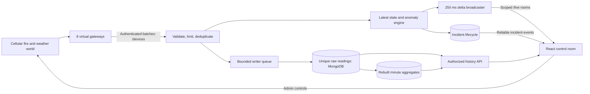

# Architecture

Rendered PlantUML system, flow, and persistence diagrams are embedded in the [README](../README.md#-architecture-diagrams). Editable `.puml` sources and PNG renders are kept together in `docs/diagrams/`. They describe the current simulated implementation.

## Data contracts

| Collection   | Identity and contents                                                                                                    | Retention                                   |
| ------------ | ------------------------------------------------------------------------------------------------------------------------ | ------------------------------------------- |
| `devices`    | Source ID, type, zone, position, gateway, nearby sources, durable sequence cursor; numeric wire index derived at startup | Persistent fleet                            |
| `gateways`   | Gateway/controller ID, key hash, zone, last-seen time                                                                    | Persistent provisioning                     |
| `users`      | Unique email, bcrypt password hash, role and authorized zones                                                            | Persistent accounts                         |
| `readings`   | Unique `(sid,seq)`, source timestamp `ts`, receive time `rx`, validated metrics and composite index                      | Default 6h by receive time                  |
| `rollups_1m` | Unique `(sid,b)`; minute bucket, count, temperature/humidity/smoke sums and extrema, peak index, maximum sequence        | Default 24h by bucket                       |
| `alerts`     | Source, zone, type, severity, state, active flag, acknowledgment and bounded 50-entry timeline                           | Persistent; recent-list query covers 7 days |

Minute aggregates cover forest sensors; weather-station detail uses raw history up to 6 hours. The zone history view combines aggregate sums and counts, rather than averaging sensor averages with unequal sample counts. Weather, terrain, and fire behavior are simulated; the basemap is independent of the telemetry.

## Ingestion and persistence

1. Gateways authenticate with an ID and a key derived from `FLEET_SECRET`; the database stores only its hash. Controller connections cannot ingest sensor readings.
2. Zod validates batches and metrics. Gateway/source token buckets, source ownership, clock-skew bounds, and queue admission protect the pipeline.
3. A bounded per-source sequence ring rejects recent duplicates quickly. The unique raw index remains the final deduplication boundary after ring eviction or restart.
4. Newer sequences update the in-memory state. Out-of-order accepted events are stored but cannot move the live cursor backward.
5. The writer reserves queued plus in-flight capacity. Unordered inserts run every 500 ms or on drain; uncertain failures retry without discarding the batch. Only confirmed stored sequences advance device cursors.
6. Affected minute buckets are rebuilt from canonical unique raw data. Repeated writes and duplicate delivery cannot inflate their counts.

The ACK precedes persistence. This is bounded, at-least-retry ingestion during a running process, not crash-durable exactly-once delivery. A durable queue would be needed to strengthen that contract. The application runs as one server instance; multiple independent state stores require additional coordination that this demo does not implement.

## Detection and incident state

Each source maintains an EWMA mean/variance and a 60-sample median/MAD baseline. Warmup and variance floors reduce unstable scores. Hard thresholds still work before a baseline is established; anomalous readings do not train the baseline upward.

Temperature and smoke conditions require dwell before opening an incident and lower exit thresholds with recovery dwell before resolving it. Combined heat/smoke raises suspected ignition; at least two fresh neighboring sensors in the same zone raise its severity to critical. Restricting confirmation to the same zone prevents a ranger's incident details from revealing another zone's sources. Each ignition incident records a neighbour-based bearing. The map then merges the active ignition incidents of a zone into one fire front: it starts at the first sensor to trip, points toward the centroid of all tripped sensors, and estimates speed as the farthest tripped sensor's distance from that origin over the elapsed time (shown only after 20 seconds). This follows the growth of the burning area rather than the noisy order of individual neighbours, and keeps one label per zone readable during a large event.

Stations raise low-humidity/wind incidents, and a receipt-time sweep marks silent sources offline after 10 seconds. Incidents move `open → ack → resolved` or directly `open → resolved`. Acknowledgment records who responded without changing the underlying condition. Updates reuse one active incident per source/type. Startup restores durable incidents and recent raw readings; statistical baselines warm up again.

## Socket protocol

`/devices` accepts authenticated gateway `r` batches with queued-acceptance acknowledgments. The simulator controller receives validated `control` commands and reports `sim:status`.

`/live` authenticates `handshake.auth.token`. A validated `subscribe` request supplies zones and an optional source ID. The server rechecks database-backed permissions, replaces prior rooms, clears unsent old-scope telemetry, and returns a source snapshot plus active incidents. JWT expiry disconnects the session; the client returns to sign-in. Roles are checked on HTTP requests and subscriptions; there is no in-app role-edit endpoint or immediate role-revocation broadcast.

| Event             | Payload and behavior                                                             |
| ----------------- | -------------------------------------------------------------------------------- |
| `f`               | `{epoch,ts,zone,rows}`; changed sources only, volatile/coalesced                 |
| `sensor`          | Full selected-source view plus epoch and emission time; volatile/coalesced       |
| `alert`           | Persisted incident update to authorized alert rooms                              |
| `heads`           | Every 2s: zone sequence/status cursors and station weather; repairs missed state |
| `history:changed` | Signals newly stored selected-source history, coalesced at most once per second  |
| `metrics`         | Once per second for operations/admin users                                       |

A compact row is `[index,seq,temp×10,humidity,smoke,fdi,status,frameTs-sourceTs]`. Missing temperature/humidity/smoke remain null. The initial source table carries names, coordinates, and stable indices; subsequent rows avoid repeating metadata.

Each connection holds at most five latest unsent telemetry packets: four zone streams plus one selected-source stream. Transport readiness drains them fairly; a newer packet replaces the pending packet for the same stream. Reliable alerts and recovery heads remain separate. No claim is made that all intermediate readings reach the browser. `framesSent` counts emitted recipient packets, while `bytesSent` estimates serialized application payload bytes, excluding transport framing and snapshots. The historical metrics field `e2eMs` measures source-to-broadcast-tick age **before** this transport queue, not browser receipt latency.

## History and browser consistency

The client subscribes before fetching history and buffers overlap. A history response captures an upper sequence cursor and merges persisted raw data with in-flight/queued readings. The browser deduplicates by sequence and merges later live samples without rolling current state back. Future-timestamp samples below the captured sequence remain buffered until their timestamp becomes visible.

Long-range charts use minute rollups rather than appending raw samples to aggregate points. If a bucket advances beyond the captured cursor while being read, the server returns 409 `HISTORY_CHANGED`; the client retries twice and then presents an explicit error. Periodic history refresh and storage notifications recover samples that volatile live delivery coalesced.

The store caps detail history at 10,000 points, publishes at most four times per second using animation frames, and preserves min/max values when downsampling plots. Source and incident lists are virtualized. Canvas markers and a Canvas heat layer share one Leaflet map. Epoch changes clear stale caches; reconnect subscriptions reconcile active incidents, and same-sequence status changes are ordered by server emission time. Scope changes reset paused charts so old-source samples cannot be relabeled as another source.

## Boundaries

Raw and aggregate retention are intentionally short. TTL removal is asynchronous. Incident events are reliable for a connected Socket.IO session but not a durable replay log; reconnect fetches current active incidents. The danger index and spread estimate are simulation aids. Benchmarks measure a local synthetic workload, with client receipt latency reported separately from server processing lag. See [performance results](perf/README.md).
